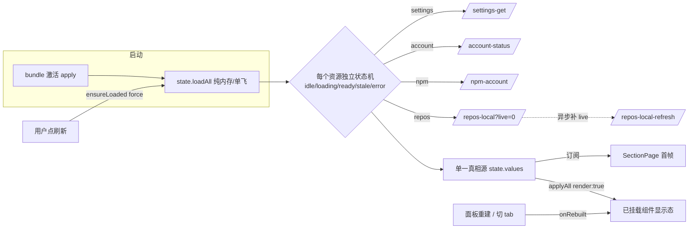
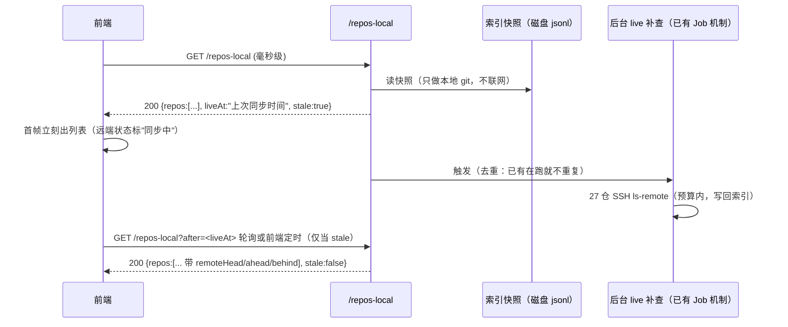

# 计划：gitpush UI 状态工厂化（对齐 ModelStage ui-state 六条契约）

> 本文是改造计划：问题定位 + 契约差距 + 落地方案 + 风险与里程碑（按 M1→M4 分批交付）
> 调研时间：2026-11-16 · 依据 = 代码逐行 + 生产实例实测（`http://10.10.31.93:30800`，浏览器真实打开）
> 目标参考实现：`ModelStage/src/web/app/ui-state.js`（559 行）+ 契约 R1/R2/R3/§三/§四/§五

---

## 一、实测证据（先证据，后结论）

在真实浏览器里冷启动页面（`location.reload()` 后立刻读 `performance.getEntriesByType('resource')`）：

| 请求 | 发起时刻 | 耗时 | 结果 |
|---|---|---|---|
| `/api/git-push/settings-get` | 823ms | **10ms** | 200 |
| `/api/git-push/account-status` | 823ms | **16ms** | 200 |
| `/api/git-push/repos-local?rebuild=0` | 824ms | **30001ms** | **status 0（客户端 abort）** |
| `/api/git-push/clone-progress` | 1571ms | 30000ms | status 0（abort） |
| `/api/git-push/api-quota` | 1572ms | 30000ms | status 0（abort） |
| `/api/git-push/npm-account` | — | — | **根本没被发起** |

同一浏览器里手工补测（干净的单发请求，页面内 fetch）：

| 请求 | 服务端真实耗时 | 结果 |
|---|---|---|
| `/api/git-push/npm-account` | **496ms** | 200，`loggedIn:true / configured:true`，`block:"✅ 凭据可用 ✅ npm token：…"` |
| `/api/git-push/repos-local?rebuild=0` | **87,496ms** | 200，`count:27`（40KB 响应体） |

结论先行：**后端 npm 接口完全正常且很快（0.5s）；UI 上那句「⚠️ 未配置 npm token」是假话** —— 因为前端压根没请求过它。
而仓库列表接口真慢（**87.5s**），前端 30s 必先超时。

> 测量口径说明（避免循环论证）：87.5s 是**单发、无并发干扰**的那一次；随后两次复测（87.7s / 89.2s）可能与前一发重叠，只作数量级佐证，不作精确值。

---

## 二、每个现象的根因（一句话 + 文件:行号）

### 现象 1：npm 账号每次进 UI 要手动点「刷新」

**根因链（三行代码）**：

1. `lib/client-parts/git/apply.js:39-40` —— 挂载时只预读 **GitHub 账号**与**本地仓库**，**没有 npm**：
   ```js
   void controller.refreshAccount();                   // GitHub：有
   void controller.scanLocalRepos(savedPath, false);    // 本地仓库：有
   // ← 没有 refreshNpmAccount() / loadNpmOwned()
   ```
2. `lib/client-parts/git/controller.js:34` —— `npmConfigured` 初值 `false`，只有 `refreshNpmAccount()` 才会改成真值（`controller.js:319-334`）。
3. `lib/client-parts/git/npm.js:298` `configured: !!s.npmConfigured` → `npm.js:25` 渲染兜底文案
   `⚠️ 未配置 npm token …`。

即：**从未加载 ⇒ 值为默认 false ⇒ 界面把「没读」显示成「未配置」**。手动点「刷新」走
`props.recheckNpmAccount`（`npm.js:324` → `controller.js:337` 起）才补上 —— 这就是"只有手动刷新才触发"。

### 现象 2：GitHub 账号正常

同一个 `apply.js:39` 调了 `refreshAccount()`，所以 GitHub 每次进页面都有数据。
**两者差异只有这一处调用**，不是网络、不是后端、不是权限。

### 现象 3：本地仓库列表 `✗ 读取失败: signal timed out`

**根因链**：

1. `lib/app/handlers/repos.js:150-156` —— 列表接口**内联**做远端探测：
   ```js
   const deadline = Date.now() + LIST_LIVE_BUDGET_MS;   // 预算 15s
   list = buildLocalList(indexMap, path, deadline);      // 每仓 describeRepo + git log（同步）
   await applyLiveRemote(list, deadline);                // 27 个仓库 × SSH ls-remote
   ```
2. `lib/app/handlers/http-constants.js:5` `LIST_LIVE_BUDGET_MS = 15_000`，
   `lib/git/transport.js:488-489` 单步上限 `META_STEP_TIMEOUT=3s` / `LS_TIMEOUT=8s`，并发 `PROBE_CONCURRENCY=4`。
   27 仓 ÷ 4 并发 × 8s ≈ 54s，加同步 git 调用与开销 ⇒ **实测 87.5s**（预算是 15s，实际穿透 5.8 倍）。
3. `lib/client-parts/git/utils.js:14` `AbortSignal.timeout(dshgp_FETCH_TIMEOUT_MS)`，
   `const.js:23` `dshgp_FETCH_TIMEOUT_MS = 30_000` ⇒ 30s 客户端 abort。
4. 失败无自愈：`controller.js:590-592`
   ```js
   } catch (e) { this.localRepos = []; this.localMsg = '❌ 读取失败: ' + (e && e.message || e); }
   ```
   —— 清空列表 + 把错误写进**与成功文案同一个字段**（`localMsg`），无重试、无 stale 标记、无错误态。

**结构性病**：列表这种「应该秒开的读接口」被绑上了 27 次网络探测；而项目里其实**已经有异步补充通道**
`/repos-local-refresh`（`http-handlers.js:144`，客户端 `controller.js:607-...` 的 `refreshUnknownRemote()` 正在用），
列表接口却仍在同步做同一件事。

### 现象 4：不是每次重启进 UI 都已加载完

**根因**：加载是「**一次性 + 发完就不管**」，且**与面板生命周期无关**。

1. `apply.js:39-40` 用 `void` 丢出去（fire-and-forget），没有任何"读完"门禁；
2. `apply.js:48-53` `SectionPage` 只判断 `state.available`，**没有加载门禁**，首帧渲染在数据回来之前；
3. **没有面板重建钩子**：`account.js:72` 明确写着"这里**不再**挂载时刷新"，而条件渲染
   `page.js:26`（`tab === 'account' ? … : …`）每次切 tab 都会重建组件 → 重建后**不会重读**；
4. 一次失败就永久失败（`controller.js:594` 只写文案，没有重试或下次进入重试）。

所以"重启进入是否已加载完"取决于**那次冷启动的请求有没有在用户抬眼看之前回来**——
settings/account 是 10~16ms（肉眼无感），repos 是 87.5s（必失败），npm 是永不发起。

---

## 三、差距分析：现状 vs ModelStage 六条契约

| 契约 | 现状判定 | 具体位置（文件:行号） |
|---|---|---|
| **R1** 单一真相源（禁止控件留显示副本） | ❌ **不符合** | `npm.js:129-137`：`dshgp_NpmPanel` 自己 `useState` 一份 `acct/pkgs` 并独立 `fetch('/npm-account')`（`npm.js:144-146`），与 controller 的 `npmAccount*`（`controller.js:319-334`）构成**两份 npm 真相**；`npm.js:25` 还拿渲染期兜底文案当状态 |
| **R2** 读回早于首次渲染 | ❌ **不符合** | `apply.js:39-40` `void` 丢出；`apply.js:48-53` `SectionPage` 无 ready 门禁。实测首帧时 `settings-get/account-status` 在 t≈823ms 才回来，repos 永不回来 |
| **R3** apply 与 render 分离（render 可重放） | ⚠️ **部分符合** | 已有 `store.createSnapshotStore` + `useSyncExternalStore`（`controller.js:76-90`、`apply.js:42-45`），订阅是真的；但**没有"按当前值重放显示态"的入口**，也没有单项 render 契约；错误/加载态与数据态混在同一批字段（`localMsg`、`npmAccountBlock`） |
| **§三** 面板重建后 `panel:rebuilt` + `applyAll({render:true})` | ❌ **不符合** | 全包无 `panel:rebuilt`/`rebuilt` 事件；`account.js:72` 注释即"重建不重读"的明文；切 tab 重建（`page.js:26`）后不补数据 |
| **§四** 能力不支持 ⇒ 保留值、不回落默认 | ❌ **不符合** | `controller.js:590-592`（repos 失败清空列表）、`controller.js:332-334`（npm 失败把 loggedIn 置 false）—— **失败=回落默认**，正是契约禁止的行为 |
| **§五** 默认值唯一来源 = schema | ⚠️ **部分符合** | 默认值有三处：`lib/client/index.js:16-26`（`DEFAULT_CONFIG` + `SETTINGS_SCHEMA`）、`lib/app/schema.js:82+`（`Config`）、`controller.js:7-30`（字段字面量，如 `this.maxCloneFileMB = 10`、`this.npmInstallBusy = ''`）。前两处靠测试钉住一致（`test-settings-persistence.mjs` L0/L1/L2），第三处无来源、纯手写 |

---

## 四、改造方案

### 4.1 数据流（目标）



### 4.2 新建：`lib/client-parts/git/state.js`（一次成型，别叫 ui-state 免得跟参考实现混淆）

| 导出 | 职责 | 对应契约 |
|---|---|---|
| `SPEC` | 从 `SETTINGS_SCHEMA` + 资源清单派生（默认值唯一来源） | §五 |
| `registerResource(name, {load, timeoutMs, retry})` | 资源注册（settings/account/npm/repos/cloud） | R1 |
| `loadAll({force})` | 并发读全部到内存、**单飞**（同资源不并发重复请求）、逐资源超时 | R2 |
| `getValue(name)` / `getAll()` | 唯一读入口（组件只许从这里读） | R1 |
| `getStatus(name)` | `idle/loading/ready/stale/error{msg,at}` | §四 |
| `applyAll({render})` | 幂等下发 + 重放显示态 | R3 |
| `onRebuilt(fn)` / `markRebuilt()` | 面板重建钩子 | §三 |
| `ensureFresh(name)` | 面板挂载时"没有数据或已过期才去读"（不制造请求风暴） | §三 |

关键设计点（每条都是现状缺陷的直配）：
- **失败不清空**：`error` 只改状态位，`values[name]` 保留上一次成功值并标 `stale`（§四）；
- **单飞 + 去重**：同一资源在 `loading` 时不重复发起（防 `AccountSwitcher`/`NpmPanel` 双请求）；
- **超时按资源分别给**：settings/account/npm 用 10s，repos 用 15s（并对失败自动重试 1 次，退避 1s）；
- **默认值只从 schema 派生**：删掉 `controller.js:7-30` 里与 schema 重复的字面量（保留纯 UI 局部字段，如对话框开关）。

### 4.3 要改的文件（按改动量排序）

| 文件 | 改什么 | 为什么 |
|---|---|---|
| `lib/client-parts/git/state.js` | **新建**（约 220 行，第 8.5 片插在 const 后、controller 前） | 工厂本体 |
| `lib/client-parts/git/apply.js` | 第 39-40 行换成 `state.loadAll()`；`SectionPage` 加 ready 门禁 + 骨架；注册 `onRebuilt` | R2/§三 |
| `lib/client-parts/git/controller.js` | 各 `refreshXxx()` 改为"调 state.ensureFresh(x)"；删重复字段与错误落同一字段的写法 | R1/§四 |
| `lib/client-parts/git/npm.js` | 删 `dshgp_NpmPanel` 的本地 `useState` 副本（129-137、144-146）；文案分三态："还没读取 / 读取失败（可重试）/ 真正未配置" | R1/§四 |
| `lib/client-parts/git/account.js` | 删"不再挂载刷新"注释与依赖；由 state 门禁驱动 | §三 |
| `lib/client-parts/git/page.js` | 切 tab 时调 `state.ensureFresh()`（幂等，有数据不请求） | §三 |
| `lib/app/handlers/repos.js` | **列表接口不再内联 live 探测**（见 4.4） | 现象 3 |
| `scripts/build-client.mjs` | `PART_ORDER` 插入新分片（分片顺序是唯一权威） | 产物 |
| `test/tool/test-cli.mjs` 等 | 断言产物文本的地方跟着改（见风险 5） | 门禁 |

### 4.4 现象 3 的后端部分：**慢读出请求路径（快照 + 后台补）**

先纠正一个容易走偏的理解：现状**已经是「后端读、前端显示」**——前端不读文件、不跑 SSH，
所有数据都来自后端 HTTP（`utils.js:13-27`）。所以「后端读」本身不能消除超时：
**是那个 HTTP 请求在服务端跑了 87.5 秒**，任何客户端（前端 fetch、curl）都要等 87.5 秒。
要做对，唯一有效的是把「慢的那半」挪出请求路径。

#### 形态（推荐）



改动只在后端一个接口 + 一个后台任务登记，前端仍是「拉取 + 显示」：

```js
// 改前（repos.js:150-156）
const deadline = Date.now() + LIST_LIVE_BUDGET_MS;   // 15s
list = buildLocalList(indexMap, path, deadline);
await applyLiveRemote(list, deadline);                // ← 27 次 SSH，实测 87.5s

// 改后：请求内**只读快照**，探测交给后台
list = buildLocalList(indexMap, path);                // 不联网
const liveState = readLiveCache();                    // 上次 live 结果 + 时间戳
// 过期（> 5 分钟）⇒ 触发一次后台补查（单飞去重；已有 job 在跑就跳过）
if (isStale(liveState)) void enqueueLiveProbe(list);
return { ok: true, repos: mergeLive(list, liveState), liveAt: liveState.at, stale: isStale(liveState) };
```

现成可复用的东西（不必新造）：
- 后台任务：`ctx.jobs`（`lib/app/plugin/index.js` 的 `startHostJob`，`git_commit_push` 与 history 审计都在用）；
- 单发探测函数：`liveRemoteHeadAsync`（`transport.js:469`，已支持 `budgetMs` 分摊）；
- 前端"补查"入口：`controller.js:607+` 的 `refreshUnknownRemote()`（现在只在 `liveSkipped` 时补，改成"stale 就补"即可）。

#### 与 UI 状态工厂的关系（两者互补，谁也替代不了谁）

| | 解决什么 | 不解决什么 |
|---|---|---|
| 快照 + 后台补（本节） | 「慢」：请求变成毫秒级，超时消失 | 读失败怎么显示、重建后是否重放、npm 为什么没读 |
| 状态工厂（4.2） | 「读没读、读失败、读旧了」三态可见 + 重建重放 + 单一真相 | 后端依旧慢（87.5s 仍然超时） |

所以建议：**M1/M2 做工厂（治 npm 与首帧/重建），M3 做本节（治 87.5s）**，两件事都要，顺序可按你的偏好调。

---

## 五、风险清单（对照本项目已有教训）

1. **分片不能单文件 `node --check`**：`lib/client-parts/**` 边界本就不闭合 ⇒ 唯一验证是
   `node scripts/build-client.mjs && node --check lib/client.js`（本轮我已因分片验证吃过这条）。
2. **`PART_ORDER` 是拼接顺序唯一权威**：新分片必须插在 `const.js` 之后、`controller.js` 之前（controller 要用工厂），
   且文件顶层零声明、命名带 `dshgp_` 前缀（`package.json` 的 `dshScopeCheck` 会拦）。
3. **cordis `apply` 里不能长 await**：插件激活有超时预算 ⇒ `loadAll` 不能 await 在 apply 里，
   必须「首帧用 ready 门禁 + 骨架」而不是「等数据再渲染」。
4. **不能引入第二套订阅**：已有 `store.createSnapshotStore` + `useSyncExternalStore`（`controller.js:76-90`），
   工厂要么复用它、要么替换它，**不能两套并存**（那正是"双份真相"）。
5. **改产物文本会牵动现有断言**：`test/tool/test-cli.mjs` 里有对 `lib/client.js` 源文本的断言
   （如 `this.preCommitEnabled = false`、设置键引用、enum 选项）。改分片后要逐条跑，别把测试改成"跟着实现走"。
6. **后端拆分会让"列表首帧没有 live 状态"**：要显式显示"远端状态同步中"，否则用户以为 ahead/behind 是 0。
7. **范围纪律**：本轮只碰 UI 状态层 + 列表接口的一个开关；**20 个工具 / 2 个 CLI / 审计包公开面一律不动**。

---

## 六、工作量与验收（每步可独立验收）

| 里程碑 | 内容 | 预估 | 验收标准（硬） |
|---|---|---|---|
| **M1** 工厂骨架 + npm/GitHub 对称 | `state.js` + `apply.js` 接 `loadAll` + `controller` 改调用 | 半天 | 冷启动进入设置页：**`/npm-account` 被自动请求**且 NPM 卡显示 ✅（不再需要点刷新）；`/account-status`、`/settings-get` 仍正常 |
| **M2** 三态 + 重试 + 重建重放 | `getStatus` + `applyAll({render})` + `onRebuilt` | 半天 | 断网/超时时卡片显示"读取失败（可重试）"且**不清空**上一次数据；切 tab 来回不产生重复请求（network 计数可证） |
| **M3** 列表改快照 + 后台补（后端） | `repos.js` 只读快照 + 后台 job 补 live + 前端「同步中」标记 | 半天 | `/repos-local` P95 **< 500ms**（不含任何 SSH）；首帧即出列表；~1 个后台周期后 ahead/behind 补齐（network + 索引 jsonl 双证据） |
| **M4** 收口 | 删 `controller.js:7-30` 重复默认值、删 npm 子页本地副本、更新测试与文档 | 半天 | 全量测试 0 fail；`check.mjs` 通过；`lib/client.js` 语法通过；两 CLI 与 20 工具行为不变（回归对比） |

---

## 七、不确定项（需要拍板，请选）

**Q1 首帧策略**
- **A（推荐）** 骨架 + ready 门禁：首帧就渲染骨架/「读取中」，数据到了填充。慢请求不会让页面像"空的"。
- **B** await 到读完再渲染：一出来就是全的，但慢时首屏空白，且与 cordis apply 超时冲突。
- **C** 维持现状（先渲染空）+ 只加重试：改动最小，但"不是每次都加载完"的观感依旧。

**Q2 `/repos-local` 的 live 探测怎么办（你提的「后端读、前端显示」已并入 A）**
- **A（推荐）** **快照 + 后台补**：请求内只读索引快照（毫秒级），过期的远端状态由后端后台任务补查并写回快照，前端仍只做拉取显示；列表上标「远端状态同步中」。
- **B** 只把预算真正收到 5s（+ 前端超时提到 45s 兜底），仍内联探测：改动最小，但慢仓多时依旧会碰到上限。
- **C** 列表完全不返回 live 状态，只在用户点「刷新」时同步探测：最快最稳，但列表默认看不到 ahead/behind。

**Q3 是否引入状态工厂这一层**
- **A（推荐）** 引入（`state.js`），一次把 R1/R2/§三/§四/§五 补齐。
- **B** 只做最小修：补 `refreshNpmAccount` 调用 + 首帧门禁 + 失败不清空，不建工厂（约 1/3 工作量，契约仍不满）。

**Q4 `dshgp_NpmPanel` 的本地 `useState` 副本是否本轮一并并入工厂**
- **A（推荐）** 一并做（R1 彻底，删 129-137/144-146）。
- **B** 先不动（只改账号卡），把范围压到最小。
